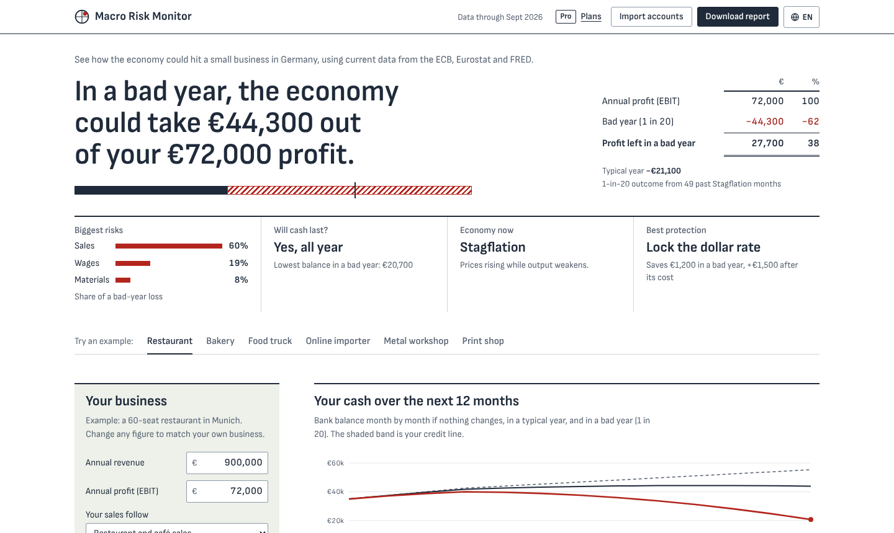
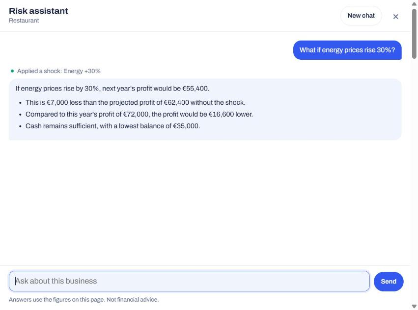

# Macro Risk Monitor

[](https://github.com/EidenWilson/macro-risk-monitor/actions/workflows/tests.yml)

**Live:** [eidenwilson.github.io/macro-risk-monitor](https://eidenwilson.github.io/macro-risk-monitor/) · [Business plan with the AI assistant](https://eidenwilson.github.io/macro-risk-monitor/?plan=business)



A risk tool for German small and mid-sized businesses (Mittelstand). It turns live macro data into one question an owner can act on: **how much of next year's profit could the economy take, and what is protection worth?**

The page answers first and explains after: a one-sentence headline, four tiles (biggest risks, whether cash lasts, the economy now, the best protection), eight basic inputs with the rest under "More detail", and the technical charts folded into one "How reliable is this?" section. It comes in three plans: **Free** for a quick check, **Pro** for the full analysis and **Business** for tax advisors and banks, with an AI risk assistant.

Built by Eiden Wilson Neralaily (data and modelling) and Channappa (finance and risk), ISM Munich.

## Highlights

- **End-to-end data pipeline.** 21 series from the ECB, Eurostat and FRED, each shifted by its publication lag, stored in SQLite and refreshed twice a month by GitHub Actions, which also opens an issue when the economic regime changes.
- **Risk model.** Filtered historical simulation over 280+ past 12-month windows, conditional on the current regime, with a 4-state hidden Markov model as a second opinion and an out-of-sample backtest since 2008 (Kupiec test).
- **Product.** Answer first, Free, Pro and Business plans, DATEV import (SKR03 and SKR04), a PDF report, 13 languages (Arabic right to left), a phone layout, no cookies, and no third-party requests outside the Business assistant.
- **AI assistant (Business).** An open model (Gemma 4) on Cloudflare Workers AI, on the free plan. It never computes numbers itself: it calls tools that run the page's own risk model. Client names never leave the browser, and a routing step plus a check of every euro amount keep it from inventing figures.
- **Tested.** Server tests and browser checks (plans, phone layout, the assistant's tools and conversation loop) run on every push.

**Stack:** Python (pandas, NumPy, SciPy, hmmlearn, SQLite) · JavaScript without a framework · Cloudflare Workers and Workers AI · GitHub Actions and Pages · Playwright



## What it does

| Feature | What the owner sees | Plan |
|---|---|---|
| Profit at risk | A 1-in-20 bad-year loss for the business, from 280+ historical 12-month windows | Free |
| Biggest risks | Where a bad year hits: each cost line's share of the loss, averaged over the worst 1-in-20 outcomes | Free |
| Cash check | Whether cash and the credit line last a bad year, and the lowest balance | Free |
| Regime compass | Whether Germany is in Recovery, Overheating, Stagflation or Contraction, and the path over the last 24 months | Free |
| Stress scenario | Profit bridge if the 2022 energy shock repeated | Free |
| More stress scenarios | 2008, 2011, the 2020 lockdown and the last 12 months as well | Pro |
| Cash runway | Month-by-month bank balance in a flat, typical and bad year, against the credit line | Pro |
| Contract calendar | When each exposure becomes live: loan resets, energy contract end, Indexmiete adjustment, minimum wage rise | Pro |
| Protection value | Net value of fixing the loan rate, fixing energy, passing on costs, hedging USD, after the cost of each | Pro |
| Backtest | Out-of-sample check of the bad-year forecast since 2008 with a Kupiec test, and which shocks the misses came from | Pro |
| Statistical second opinion | A 4-state hidden Markov model on growth and inflation levels with filtered probabilities | Pro |
| DATEV import | Reads a Summen- und Saldenliste (SKR03 or SKR04) in the browser and fills the exposures | Pro |
| Report | One-page PDF for a bank or tax advisor meeting | Pro |
| Advisor mode | Save many businesses and rank them by risk, with an alert threshold | Business |
| Risk assistant | Chat that explains the results, runs what-ifs on the model, compares clients and drafts client notes | Business |
| Since your last visit | When new data arrives: which saved businesses crossed the alert level or rose by 5 points or more, and a change of economic phase (remembered in the browser only) | Business |
| Monthly alert email | A German and English digest when new data arrives: the phase, key rates, how risk moved for typical businesses, and a link that re-ranks the advisor's own clients | Business |
| 13 languages | English, German, Spanish, French, Italian, Portuguese, Turkish, Polish, Ukrainian, Russian, Arabic (right to left), Hindi and Chinese. Opens in the browser's language; money, percentages and months follow each language (44.300 €, 44 300 €, €4,43,000, 2026年9月); reads 900.000, 900,000 or Arabic-Indic digits either way | All |
| Phone layout | Results first; the inputs open as a sheet from the bottom | All |

Prices on the plans dialog (Free, Pro €19 a month, Business €89.99 a month per office for up to 50 clients) are placeholders. This is a prototype, so anyone can switch plans to try them; `?plan=business` (or `#business` in the Claude preview) opens a plan directly.

## How it works

```
ECB Data Portal ─┐
Eurostat ────────┼─> pipeline.py ──> macro.db (SQLite, publication-lag aware)
FRED ────────────┘                        │
                                          v
                               build_data.py ──> data.json
                               (regimes, HMM, 12-month forward moves,
                                trailing volatility, scenarios)
                                          │
                                          v
                               build_page.py ──> docs/index.html (GitHub Pages)
                                          │
                               check_alerts.py ──> GitHub issue on regime change
```

**Risk assistant (Business).** The language model never computes a number. Each question goes out with a short summary of the page (about 3 KB of figures); anything new comes from three tools that run the same in-browser model as the charts:

```
 question ──> page ──> model (Claude in the preview, Workers AI on the website)
               ^          │ asks for a tool: what_if, shock or compare_clients
               │          v
               └── page runs the tool on the in-browser model and sends back the result
                          │
                          v
                answer, with an "Apply these changes to the page" button after a what-if
```

- `what_if` recalculates the business with changed figures and protection actions, `shock` applies a custom 12-month move (energy, Euribor, purchase prices, inflation, sales, the dollar, oil), `compare_clients` ranks the saved clients.
- Client names never leave the browser: the model sees codes (C1, C2, ...), a name typed into a question is swapped for its code before sending, and the page puts the names back into the answer.
- The instructions and tool definitions live in `assistant/` and are shared by the page and the server, so the two always agree.
- In the Claude preview the page asks Claude through the viewer's own account (it asks for permission once). On the website it talks to a small Cloudflare Worker in `worker/`, which adds the fixed instructions, calls a Workers AI model with function calling and returns text or tool calls in one shape whatever format the model answers in. The Worker only accepts requests from the site, limits each visitor to 12 requests a minute, can require an access code and stores nothing.

**Data.** Euribor 3M, EUR/USD, the AAA yield curve and German HICP (headline, food, energy, electricity, gas) from the ECB; industrial production, retail and food-service sales, consumer confidence and producer prices for food, metals, paper, plastics and wood from Eurostat; Brent, EU gas and the US 1-year rate from FRED. 21 series in total. Each series is shifted by its publication lag so every month only uses what was public at the time. The ECB replaced its ICP dataset with HICP (ECOICOP 2) in February 2026; the pipeline uses the new codes.

**Regimes.** The compass uses the sign of the 6-month change in 3-month-average inflation and industrial output. The HMM is a 4-state Gaussian model on their levels, fitted with 10 restarts; states are labelled from their means (Expansion, Sluggish growth, Inflation shock, Recession).

**Covid.** From March 2020 to March 2022, Covid rules closed or restricted restaurants and shops. Those sales swings came from public-health orders, not the economy, so retail and food-service windows that touch this period are left out of the risk range and the backtest, and their volatility excludes it. The 2020 lockdown is a separate stress scenario instead (before government support such as Kurzarbeit). Other scenarios that overlap the rules, such as the 2022 energy shock, measure sales over the first 12 months after the rules ended (April 2022 to April 2023).

**Risk model.** For each past month, the actual moves of rates, prices, FX and demand over the following 12 months are applied to the business, building up linearly through the year and respecting contract timing. Moves are scaled by today's volatility relative to volatility at the time (filtered historical simulation), with the past volatility floored at its median so calm periods such as zero rates do not inflate the scale. The bad year is the 5th percentile of that distribution, conditional on the current regime.

**Validation.** Since 2008, for every month the model forecast a 1-in-20 loss using only data available then and compared it with what happened (213 checks per business, target 5% of months worse than forecast):

| Example business | Worse than forecast | Kupiec test | Where the misses came from |
|---|---|---|---|
| Restaurant | 5.6% | passes (p = 0.68) | 9 of 12 in the 2021–23 energy and inflation shock |
| Bakery | 7.5% | passes (p = 0.12) | all 16 in the 2021–23 shock |
| Metal workshop | 7.0% | passes (p = 0.20) | 13 of 15 in the 2021–23 shock |
| Food truck | 1.4% | fails on the cautious side (p = 0.005) | the bad year is overstated |
| Online importer | 10.3% | fails (p = 0.002) | 2021–23 shock (11), 2014–15 dollar surge (7), 2008–09 (3) |
| Print shop | 16.0% | fails (p < 0.001) | 2021–23 paper prices (13), 2008–09 (8), 2020 (5) |

The model learns from history, so it misses shocks bigger than anything it had seen; the page says which shock each business's misses came from and, when it fails, how to read the bad year instead (for the print shop, roughly 1 in 6 rather than 1 in 20). Volatility scaling cut the restaurant's miss rate from about 21%, and taking Covid closures out of the history from 8.5%.

**Privacy and speed.** The page sets no cookies, loads nothing from third parties (the Archivo font is embedded and jsPDF is served from `docs/vendor/`), processes DATEV files and builds the PDF in the browser, and only writes to the browser's local storage once someone uses it (with a button to delete it). The exceptions are on the Business plan: when someone asks the assistant a question, the question and the page's computed figures (never client names or ledger lines) go to the assistant server and the model behind it; and when someone subscribes to the alert email, their email address (and nothing else) goes to Buttondown. The privacy page needs a paragraph on this before the assistant goes live. The backtest runs only when its section is opened.

## Run it locally

```bash
pip install -r requirements.txt
echo "FRED_API_KEY=your_key" > .env          # free key from fred.stlouisfed.org
python pipeline.py --db macro.db --start 2000-01
python build_data.py --db macro.db --out docs/data.json
python build_page.py                           # writes docs/index.html (text from i18n/, fonts from assets/, jsPDF from docs/vendor/)
python assets/og_image.py                      # optional: the link-preview picture docs/og.png
```

## Deploy (free)

1. Push this folder to a GitHub repository.
2. Settings → Secrets and variables → Actions → add `FRED_API_KEY`.
3. Settings → Pages → deploy from branch `main`, folder `/docs`.
4. Actions → "Refresh data and site" → Run workflow. It then runs twice a month by itself and opens an issue (which GitHub emails you) when the regime changes.

### The assistant server (Business plan, free)

The Workers Free plan covers it: 100,000 requests a day and 10,000 Workers AI neurons a day. The website uses Google's Gemma 4 (26B), chosen after comparing answers on the live site: about 150 questions a day, two to nine seconds each. When the allowance is used up, the assistant says so until 00:00 UTC; nothing is billed. No API keys are involved.

```bash
cd worker
npm install
npx wrangler login        # opens the browser; a free Cloudflare account is enough
npx wrangler deploy       # prints the URL, e.g. https://mrm-assistant.<your-subdomain>.workers.dev
curl https://mrm-assistant.<your-subdomain>.workers.dev/health
```

Then put that URL in `assistant/config.json` (`{"url": "https://mrm-assistant..."}`), run `python build_page.py` and push. Optional: `npx wrangler secret put ACCESS_CODE` so only people you give the code to can use it. The default model, the other models a page may ask for (`MODELS`), the allowed origins and how the model calls tools (`TOOL_MODE`) are set in `worker/wrangler.toml`. To switch the website to another model from `MODELS`, set `"model"` in `assistant/config.json` and rebuild; no redeploy is needed. If a question fails, `npx wrangler tail` in `worker/` shows the model's error while you ask again.

## Alert email (Business, free up to 100 subscribers)

`alerts/digest.py` runs in the data refresh. It opens the built page in a headless browser, reads the economy's phase, the key rates and the six example businesses' bad-year risk from the page's own model, compares them with the last email (`alerts/last.json`) and, when new data has arrived, sends a short German and English digest through [Buttondown](https://buttondown.com). The email links to `?plan=business#clients`, where the page re-ranks the businesses the advisor saved in their own browser and shows what changed since their last visit; no client data is ever sent anywhere.

1. Create a free Buttondown account and make sure new subscribers confirm by email (double opt-in, which German law expects).
2. Put the username in `alerts/config.json` (`"buttondown": "your-username"`), run `python build_page.py` and push: the sign-up form appears on the Business plan.
3. Copy the API key from Buttondown's API page and add it to the repository as the Actions secret `BUTTONDOWN_API_KEY`.

`python alerts/digest.py --dry-run` prints the next email. Without the secret, the refresh only shows the digest in its run summary, ready to paste into Buttondown. Before inviting real subscribers, the legal notice and the privacy page need to be live, and the privacy page should name Buttondown.

## Languages

All text lives in `i18n/`, one file per language; `en.js` is the source and explains the format. To add a language, copy `en.js`, translate the values, set its `_` line (name in the menu, locale for numbers and dates, `dir: 'rtl'` for right-to-left scripts, `pdf: true` only for Western European languages) and rebuild. `build_page.py` stops on a key written twice and warns about missing ones (the page shows English for those); `tests/test_page.py` checks every language for matching keys, broken text, sideways scrolling and the right-to-left layout. Archivo covers Latin scripts (with a small embedded subset for Polish and Turkish letters); Cyrillic, Arabic, Hindi and Chinese use the visitor's system fonts. The PDF's built-in fonts write Western European languages only, so other languages get an English report and are told so. The assistant answers in the language the question is written in.

## Tests

```bash
cd worker && npm test                                   # assistant server: CORS, limits, access code, all model output formats
python build_page.py && python tests/test_page.py       # browser: plans, phone layout, tools, assistant loop, all 13 languages
```

The browser checks need Playwright (`pip install playwright && python -m playwright install chromium`). They check that the assistant's tools reproduce the page's own numbers and that no client name appears in anything sent to the server or to Claude.

## Legal pages

Germany requires a legal notice (Impressum) and a privacy policy. Put `impressum.html` and `datenschutz.html` in `docs/`; `build_page.py` links them in the footer once neither contains a `[[placeholder]]`.

## Licences

Archivo font: SIL Open Font License 1.1 (`assets/OFL.txt`). jsPDF: MIT (`docs/vendor/jspdf.LICENSE.txt`).

## Limits

- History starts in 2000, so the model has seen only a handful of big shocks; it underestimates anything larger than 2022.
- Overlapping 12-month windows mean the backtest's observations are not independent.
- Hedge costs are editable assumptions; the loan fixing cost uses the ECB 1-year rate when available.
- The assistant explains the model's figures; how well it phrases them depends on the model behind it, so advisors should check an answer before passing it to a client.
- Plans are not enforced: there are no accounts or payments yet. Only the assistant server is protected (origin check, rate limit, optional access code).
- Not financial advice.
